<p align="center">
  
</p>

<h1 align="center">TWEAK IDE</h1>

<p align="center">
  <strong>The First Ever Offline AI IDE</strong><br>
  The High-Performance, Privacy-First Development Environment Built for 100% Offline AI Coding Agents, Jupyter Notebooks, Monaco Editor, and Autonomous Verified Engineering.
</p>

<p align="center">
  <a href="#-installation"></a>
  <a href="#-the-first-ever-offline-ai-ide"></a>
  <a href="LICENSE"></a>
  <a href="docs/SCREENSHOTS.md"></a>
  <a href="https://ollama.com"></a>
  <a href="https://huggingface.co"></a>
</p>

<p align="center">
  <a href="https://github.com/sherlock-dev-ai/Tweak-IDE-Local-AI-FREE/releases/download/v0.1.0/Tweak.IDE.Setup.0.1.0.exe">
    
  </a>
</p>

---

## 📌 Introduction

Modern software development demands both powerful AI pair-programming and uncompromising source code privacy. Many modern coding tools require streaming your intellectual property to closed third-party servers. 

**TWEAK IDE** is the **first ever offline AI IDE** designed from the ground up for total sovereignty. It delivers a fast desktop environment powered by Electron and Monaco, combined with **100% offline, private LLM execution** via local Ollama runtimes and optional Hugging Face cloud inference. With integrated Jupyter-style computational notebooks, automated Python toolchain detection, visual Git source control, and a real-time agent verification lifecycle, TWEAK IDE gives developers the autonomy of modern AI without sending a single line of code outside their machine.

---

## 📸 Application Preview

### 🏠 Main Page (Welcome Screen)
<p align="center">
  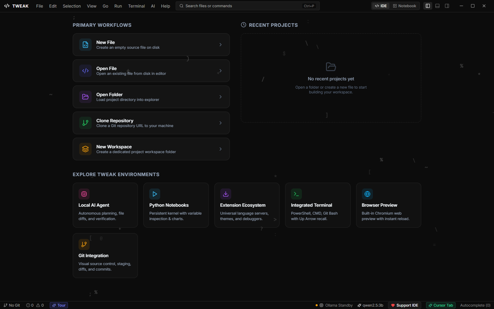
  <br>
  <em>The starting welcome screen featuring quick workspace launcher, recent project cards, and environment toggles.</em>
</p>

#### 🔍 Welcome Screen Key Features:
- **Global Command Palette (`Ctrl + P`):** Quick-open search bar in the header to search files and trigger editor commands instantly.
- **Dual IDE / Notebook Mode Switcher:** Dedicated `[</> IDE]` and `[📓 Notebook]` header toggles to switch between Monaco editing and Jupyter notebooks with one click.
- **Full Standard Application Menu Bar:** Standard desktop menus (`File`, `Edit`, `Selection`, `View`, `Go`, `Run`, `Terminal`, `AI`, `Help`) including dedicated `AI` agent controls.
- **Primary Workflows:**
  - `New File` — Creates an empty source file on disk with automatic language detection.
  - `Open File` — Opens an individual source file from disk.
  - `Open Folder` — Loads a project directory into the sidebar explorer tree.
  - `Clone Repository` — Clones any Git repository URL directly into a local workspace.
  - `New Workspace` — Sets up an isolated project workspace folder.
- **Explore Tweak Environments Hub:** Six modular runtime tiles:
  - `Local AI Agent` — Autonomous planning, file diffs, and verification.
  - `Python Notebooks` — Persistent background kernel with variable inspection and charts.
  - `Extension Ecosystem` — Universal language servers, themes, and debuggers.
  - `Integrated Terminal` — Multi-tab PowerShell, Command Prompt, and Git Bash with Up-Arrow recall.
  - `Browser Preview` — Built-in Chromium web preview with live reload synchronization.
  - `Git Integration` — Visual source control, staging, diffs, and commits.
- **Live Status & AI Telemetry:**
  - `● Ollama Online` real-time connection status pill.
  - Active model indicator (`qwen2.5:3b`).
  - Diagnostic error & warning monitor (`0 ⚠️ 0 ❌`).
  - Inline AI autocomplete toggle (`Cursor Tab`).
  - Interactive onboarding tour launcher (`Tour`).

### 📁 Workspace Landing (After Choosing a Folder)
<p align="center">
  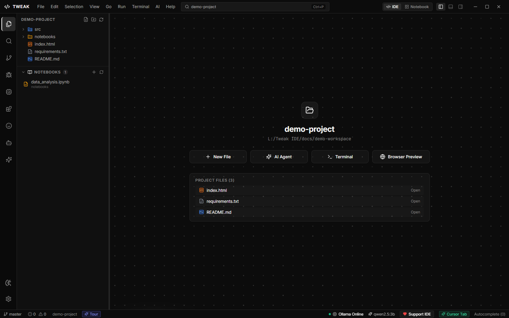
  <br>
  <em>The project landing page immediately after opening a folder, displaying project files and rapid-action launch tiles.</em>
</p>

#### 🔍 Workspace Landing Key Features:
- **7-Icon Activity Bar:** Rapid navigation between *Explorer*, *Global Search*, *Source Control*, *Run & Debug*, *Extensions*, *Settings*, and the *AI Assistant*.
- **Dedicated `NOTEBOOKS` Tree Section:** Separated explorer section that auto-indexes all `.ipynb` notebook files with quick-create `+` and refresh actions.
- **Project Landing Dashboard:** Shows active project name (`demo-project`) and exact local filesystem directory path.
- **Rapid Action Toolbar:** Direct launch buttons for `+ New File`, `✨ AI Agent`, `>_ Terminal`, and `🌐 Browser Preview`.
- **Project Files Interactive Table:** Discovered workspace files listed with file-type icons and individual **"Open"** buttons for immediate editor access.

### 💻 Main IDE Workspace & Code Editor
<p align="center">
  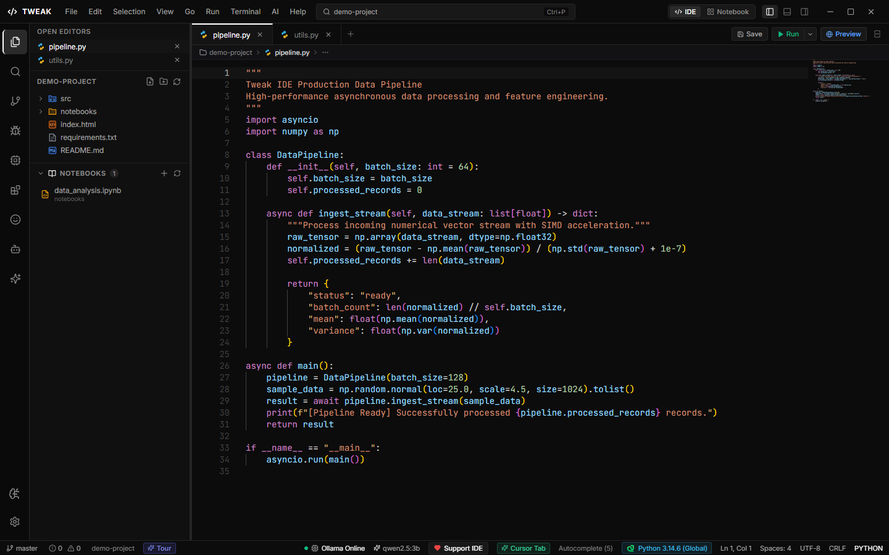
  <br>
  <em>The unified TWEAK IDE workspace with file explorer, Monaco editor, tab bar, and system status telemetry.</em>
</p>

---

## ✨ Implemented Core Features

### 🤖 Local-First AI Coding Assistant & Dual Chat
- **Private Local Execution:** Native support for local Ollama models (`qwen2.5-coder:7b`, `deepseek-r1:7b`, `llama3.2:3b`, `phi-3.5-mini`, etc.). Zero telemetry or code transmission to outside servers.
- **Dual Chat Evaluation:** Side-by-side prompt benchmarking to compare generations between two local or remote models simultaneously.
- **Smart Context Ingestion:** Multi-file workspace understanding with targeted code diff generation.

### 🛡️ Real-Time Agent Task Lifecycle & Verification
- **5-Stage Verification Protocol:** Autonomous plan generation, file inspection, syntax verification, unit test execution, and completion reporting.
- **Unified Diff Review:** Visual inline diffs with granular single-file and bulk `Accept All` / `Reject All` controls.
- **One-Click Revert:** Instant rollback mechanisms for safe agentic code changes.

<p align="center">
  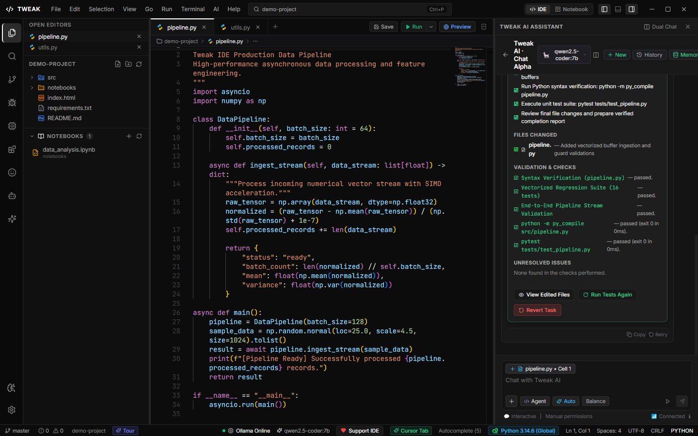
  <br>
  <em>Autonomous agent task lifecycle showing verified regression suites and unified file diffs.</em>
</p>

### 🧠 Model Hub & Hugging Face Provider Integration
- **Model Hub:** Interactive catalog to search, install, pause, or switch local models with progress feedback.
- **Hugging Face Cloud Inference:** Connect remote models with masked, encrypted token storage for hybrid local/cloud workflows.
- **Zero Configuration Fallback:** Automatic health checks with actionable diagnosis when local runtimes are offline.

<p align="center">
  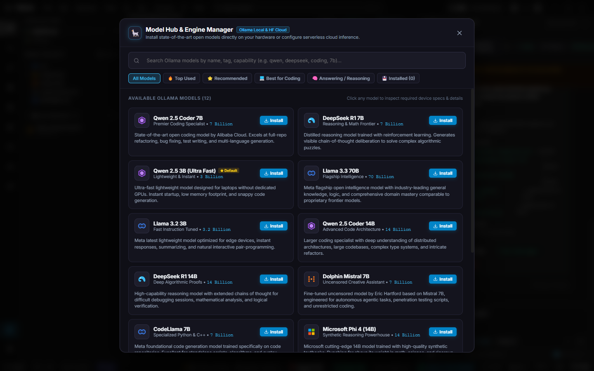
  <br>
  <em>Integrated Model Hub offering one-click model downloads and local inference management.</em>
</p>

### 📓 Interactive Jupyter-Style Python Notebooks
- **Persistent Kernel Execution:** Run `.ipynb` notebook files with cell-by-cell execution, code formatting, and markdown rendering.
- **Live Variable Inspector:** Real-time memory inspection table tracking dataframes, NumPy arrays, tensors, and primitive values.
- **Switch Modes Seamlessly:** Single-click toggle between standard IDE code editing and interactive notebook exploration.

<p align="center">
  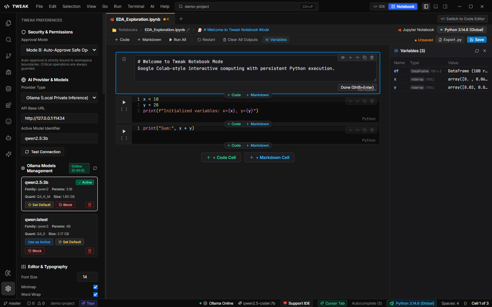
  <br>
  <em>Interactive notebook environment with live Variable Inspector tracking arrays and DataFrames.</em>
</p>

### ⚡ Monaco Code Editor & Developer Toolchains
- **Industry-Standard Editing:** Full Monaco editor engine featuring multi-tab management, breadcrumbs, line numbers, and minimap.
- **Python Environment Wizard:** Automatic discovery of system Python interpreters, virtual environments (`.venv`), and Conda environments.
- **Integrated Terminal Multiplexing:** Multi-tab PowerShell, Command Prompt, and Git Bash support.
- **Clean Output Runner:** Dedicated high-throughput execution channel showing program output without terminal escape noise.

<p align="center">
  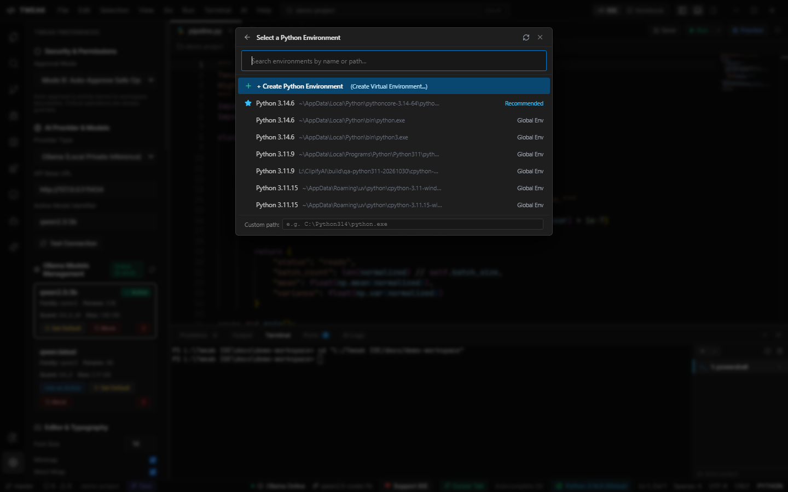
  <br>
  <em>Auto-detected Python environments and virtual environment configuration.</em>
</p>

### 🌿 Git Source Control & Built-in Web Browser Preview
- **Visual Git Manager:** View staged changes, review modified files, stage/unstage lines, and commit with message generation.
- **Embedded Browser Preview:** Live Chromium web tab synced to local preview servers (`http://localhost:4173`) for web applications.

<p align="center">
  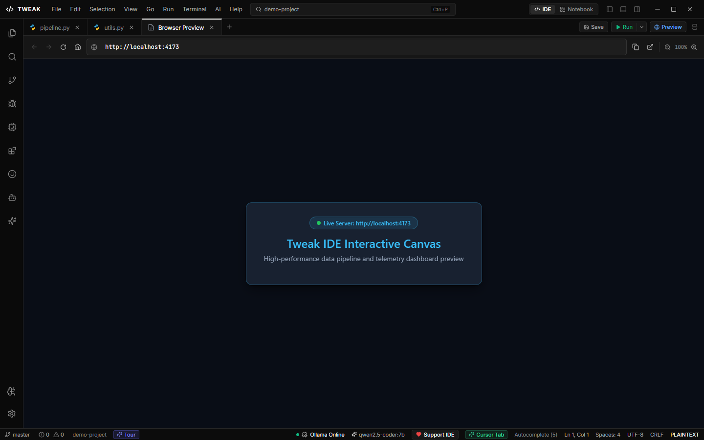
  <br>
  <em>Integrated Chromium browser preview displaying real-time web application output.</em>
</p>

---

## 🎨 Theme Gallery

TWEAK IDE includes four developer-tailored themes:

| Obsidian (OLED Pitch Black) | Rose Quartz |
| :---: | :---: |
| 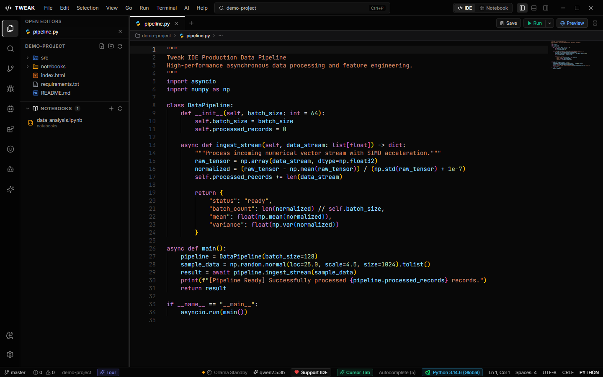 | 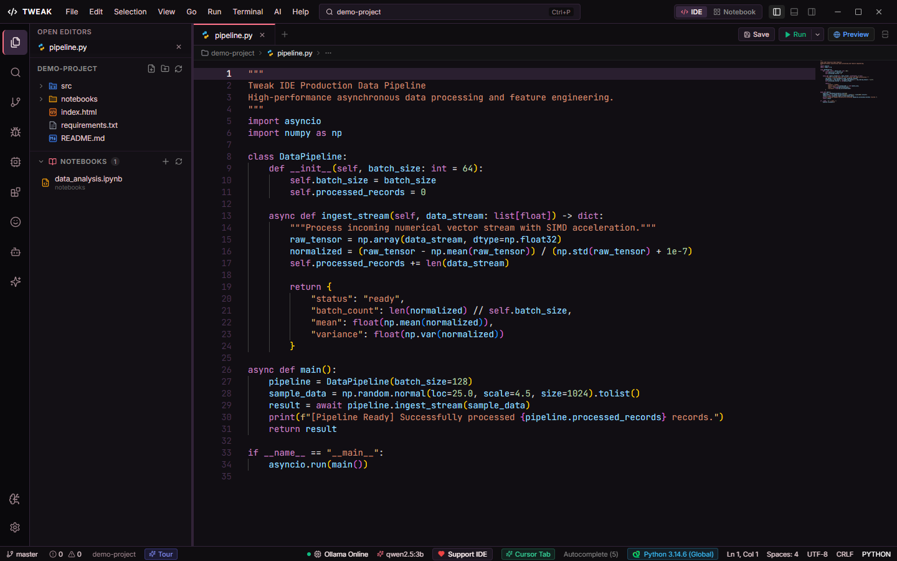 |

| Verdant (Forest Emerald) | Midnight (Deep Ocean) |
| :---: | :---: |
| 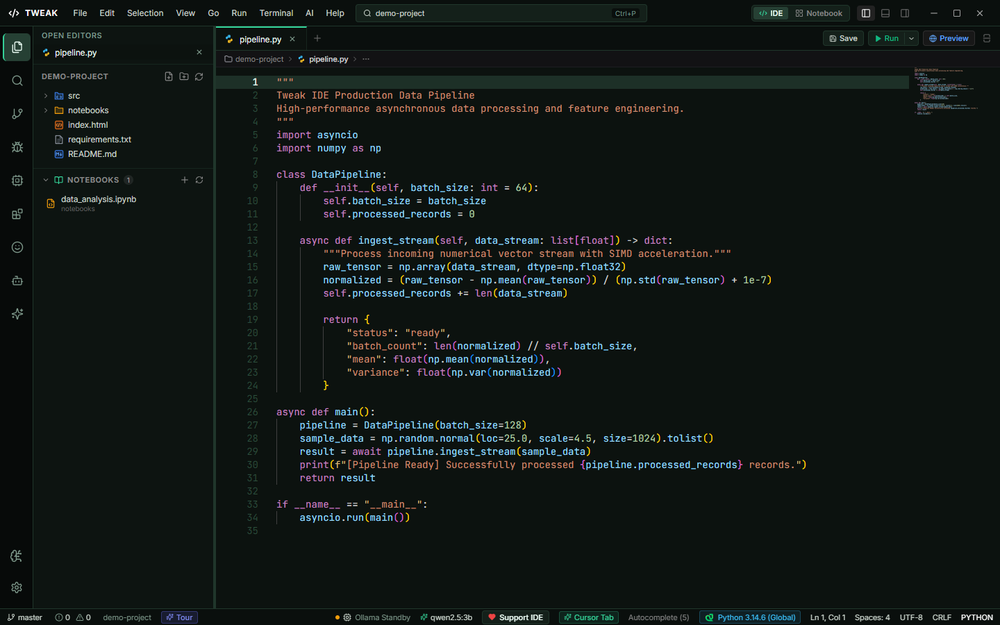 | 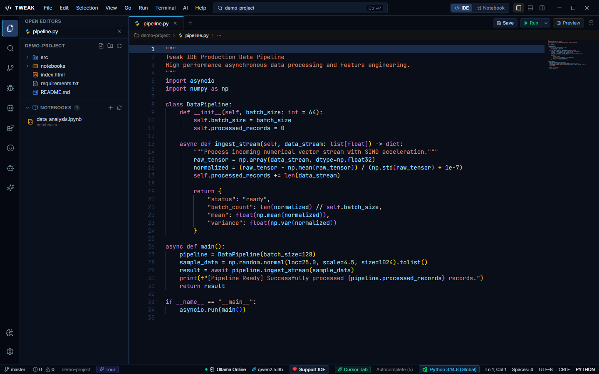 |

*Explore all high-resolution captures in the [Full Screenshot Gallery](docs/SCREENSHOTS.md).*

---

## 📦 Installation Guide

### Windows 10 / 11 (64-bit)

1. **Download the Official Installer:**
   - [**Download Tweak.IDE.Setup.0.1.0.exe**](https://github.com/sherlock-dev-ai/Tweak-IDE-Local-AI-FREE/releases/download/v0.1.0/Tweak.IDE.Setup.0.1.0.exe)

2. **Run the Setup Wizard:**
   - Open your **Downloads** folder and double-click `Tweak.IDE.Setup.0.1.0.exe`.
   - *Or launch via PowerShell from any location:*
     ```powershell
     Start-Process "$HOME\Downloads\Tweak.IDE.Setup.0.1.0.exe"
     ```
   - Follow the setup wizard to install TWEAK IDE (defaults to `%LOCALAPPDATA%\Programs\Tweak IDE` with no admin rights required).
   - Desktop and Start Menu shortcuts will be created automatically.

3. **Verify Checksum (Optional):**
   To verify cryptographic integrity in PowerShell from any directory:
   ```powershell
   Get-FileHash "$HOME\Downloads\Tweak.IDE.Setup.0.1.0.exe" -Algorithm SHA256
   ```
   *Expected SHA-256 Hash:*
   ```
   3FDBFB58D03345088E76284A037F0EC5C1B5DD75FDC1797F08B31DADA695ADBF
   ```

---

## 💻 System Requirements

| Specification | Minimum Requirement | Recommended (Local AI) |
| :--- | :--- | :--- |
| **Operating System** | Windows 10 64-bit (Build 19041+) / Windows 11 | Windows 11 64-bit |
| **Processor** | 4-Core x86_64 CPU | 8-Core Intel Core i7 / AMD Ryzen 7 or higher |
| **RAM** | 8 GB RAM | 16 GB - 32 GB RAM (for 7B/14B quantized models) |
| **GPU** | Integrated Graphics | NVIDIA RTX 3060 / 4060 or better (CUDA support) |
| **Disk Space** | 1.5 GB for IDE & toolchains | 20+ GB SSD space for local LLM weights |
| **Python** | Python 3.9+ | Python 3.11+ with `numpy`, `pandas`, `pytest` |

---

## 🚀 Getting Started

### 1. Opening a Workspace
- On the **Welcome Screen**, click **Open Folder** or press `Ctrl + O` to select any existing project directory.
- TWEAK IDE will automatically scan the project tree and index local files.

### 2. Using the Monaco Editor & Running Python
- Click any file in the Explorer sidebar to open it.
- To execute a Python script, click the **Run** button on the top toolbar or press `F5`. Clean execution outputs will stream to the bottom panel.

### 3. Launching Interactive Notebooks
- Click the **Notebook** switch button in the title bar or open any `.ipynb` file.
- Use `Shift + Enter` to execute individual notebook cells.

### 4. Setting up Local AI with Ollama
1. Download and install [Ollama](https://ollama.com).
2. Ensure Ollama is running (`ollama serve`).
3. In TWEAK IDE, open the **Model Hub** (`Ctrl + Shift + M`) and click **Install** on your preferred coding model (e.g. `Qwen 2.5 Coder 7B`).
4. Open the AI Assistant panel (`Ctrl + L`) and start pair-programming with full privacy.

---

## ⌨️ Verified Keyboard Shortcuts

| Shortcut | Action |
| :--- | :--- |
| `Ctrl + P` | Open Quick Open / Command Palette |
| `Ctrl + L` | Toggle AI Coding Assistant Panel |
| `Ctrl + \`` | Toggle Integrated Terminal Panel |
| `Ctrl + B` | Toggle Left Sidebar |
| `Ctrl + S` | Save Current File |
| `Ctrl + Shift + S` | Save All Tabs |
| `Ctrl + W` | Close Active Tab |
| `F5` | Run Active Python File |
| `Shift + Enter` | Execute Current Notebook Cell |
| `Escape` | Dismiss Modals & Guided Tour |

---

## 🔒 Security & Privacy

- **Local Inference by Default:** Prompts and code snippets processed through local Ollama models never leave your computer.
- **Masked Credentials:** Remote Hugging Face API keys are stored with masking and isolated from logs and telemetry.
- **Explicit Approval Guard:** Code proposals and terminal commands require developer approval unless autonomous mode is explicitly authorized.

---

## 🛠️ Troubleshooting

### Ollama Runtime Offline Warning
- **Symptom:** Status bar displays `Ollama Standby` or AI Assistant alerts that local Ollama is offline.
- **Solution:** Verify that Ollama is installed and running by testing `http://127.0.0.1:11434` in your browser. Launch Ollama from your Start menu or run `ollama serve` in a terminal.

### Python Interpreter Not Selected
- **Symptom:** Terminal output displays interpreter warning.
- **Solution:** Click the Python status pill on the bottom right or open the Command Palette (`Ctrl + P`) and select `Select Python Interpreter`. Choose any detected virtual environment or global interpreter.

---

## 📄 License & Attribution

TWEAK IDE is distributed under the [MIT License](LICENSE). 
Monaco Editor is a trademark of Microsoft Corporation. Ollama is licensed under the MIT License.
